# Vendora Modular ERP — Software Requirements Specification (SRS)
## Master Index & Architecture Blueprint for 30 Business Types

---

### Document Information
- **System**: Vendora Multi-Tenant SaaS & Offline Modular ERP Platform
- **Scope**: Master Architecture, Shared ERP Core, 15 Cross-Industry Engines, 30 Industry-Specific Business Types
- **Standard**: ISO/IEC/IEEE 29148:2018 (Systems and Software Engineering — Life cycle processes — Requirements engineering)
- **Version**: 3.0.0
- **Status**: Approved Architectural Master Specification

---

## 1. Executive Summary & Architectural Philosophy

Vendora ERP adopts a **Layered Modular Architecture** designed to support 30 distinct business types without code duplication or vendor lock-in. Rather than developing 30 disconnected silos, the platform establishes:

1. **Shared ERP Core**: A common, robust foundation handling multi-tenancy, authorization (RBAC), chart of accounts, general ledger, sales orders, purchase orders, inventory ledgers, employee records, and audit logging.
2. **15 Reusable Cross-Industry Engines**: Autonomous, decoupled engines (e.g., Workflow, Scheduling, Pricing, Subscription Billing, Quality Management, Document Management, Printing & Hardware).
3. **30 Specialized Industry Packages**: Modular extensions grouped across 6 strategic phases that inject domain-specific data entities, workflows, validation rules, screen manifests, and compliance reports.
4. **Multi-Deployment Substrate**: Seamless operation across Cloud SaaS, Local Offline Desktop (.exe with SQLite and HMAC licensing), Local Area Network (LAN), and Dedicated VPS.

---

## 2. Master Taxonomy of the 30 Business Types

```mermaid
flowchart TD
    VendoraCore["Vendora Shared ERP Core (83 Core Reqs)"]
    
    VendoraCore --> Phase1["Phase 1: Core Business Systems"]
    VendoraCore --> Phase2["Phase 2: Distribution & Logistics"]
    VendoraCore --> Phase3["Phase 3: Service-Based Systems"]
    VendoraCore --> Phase4["Phase 4: Manufacturing & Production"]
    VendoraCore --> Phase5["Phase 5: Projects & Infrastructure"]
    VendoraCore --> Phase6["Phase 6: Highly Specialized Systems"]

    Phase1 --> B01["01. Retail ERP (RET)"]
    Phase1 --> B02["02. Restaurant / Café ERP (RES)"]
    Phase1 --> B03["03. Pharmacy ERP (PHA)"]
    Phase1 --> B04["04. Accounting & Consulting Office (CON)"]
    Phase1 --> B05["05. School & Education Institute (EDU)"]

    Phase2 --> B06["06. Wholesale & Distribution (WHO)"]
    Phase2 --> B07["07. Logistics & Transportation (LOG)"]
    Phase2 --> B08["08. 3PL & Warehouse Management (WMS)"]
    Phase2 --> B09["09. E-commerce ERP (ECS)"]

    Phase3 --> B10["10. Clinic & Hospital ERP (HLT)"]
    Phase3 --> B11["11. Law Firm ERP (LAW)"]
    Phase3 --> B12["12. Travel Agency ERP (TRV)"]
    Phase3 --> B13["13. Hotel & Hospitality ERP (HOT)"]
    Phase3 --> B14["14. Gym & Sports Club ERP (GYM)"]
    Phase3 --> B15["15. Salon & Spa ERP (SAL)"]
    Phase3 --> B16["16. Agency, Translation & Design (AGE)"]
    Phase3 --> B17["17. Field Service & Maintenance (FSM)"]

    Phase4 --> B18["18. Discrete Manufacturing ERP (MFG)"]
    Phase4 --> B19["19. Food & Beverage Process Mfg (FOD)"]
    Phase4 --> B20["20. Pharma & Chemical Process Mfg (PHM)"]
    Phase4 --> B21["21. Printing & Packaging ERP (PRN)"]

    Phase5 --> B22["22. Construction & Contracting ERP (CST)"]
    Phase5 --> B23["23. Real Estate & Property Mgmt (RE)"]
    Phase5 --> B24["24. Agriculture & Farm ERP (AGR)"]
    Phase5 --> B25["25. Energy & Power Plant ERP (ENG)"]

    Phase6 --> B26["26. Banking & Financial Institution (BNK)"]
    Phase6 --> B27["27. Insurance ERP (INS)"]
    Phase6 --> B28["28. Government & Nonprofit ERP (GOV)"]
    Phase6 --> B29["29. Entertainment & Gaming ERP (ENT)"]
    Phase6 --> B30["30. Oil & Gas Operations ERP (OIL)"]
```



---

## 3. Specification Structure & Documentation Index

This specification is organized into detailed documents, each referencing shared requirements by ID:

| Document | Path | Scope |
|---|---|---|
| **Shared ERP Core SRS** | [`01_SHARED_ERP_CORE_SRS.md`](file:///home/ammar/projects/Vendora/docs/srs/01_SHARED_ERP_CORE_SRS.md) | CORE (01-15), FIN (01-15), CRM (01-08), PUR (01-08), INV (01-10), HR (01-10), SYS (01-10), NFR (01-15), 15 Engines |
| **Phase 1: Core Business Systems** | [`02_INDUSTRY_SPECIFICATIONS_PHASE1_CORE.md`](file:///home/ammar/projects/Vendora/docs/srs/02_INDUSTRY_SPECIFICATIONS_PHASE1_CORE.md) | Retail (RET), Restaurant (RES), Pharmacy (PHA), Consulting (CON), School (EDU) |
| **Phase 2: Distribution & Logistics** | [`03_INDUSTRY_SPECIFICATIONS_PHASE2_DISTRIBUTION.md`](file:///home/ammar/projects/Vendora/docs/srs/03_INDUSTRY_SPECIFICATIONS_PHASE2_DISTRIBUTION.md) | Wholesale (WHO), Logistics (LOG), 3PL / WMS (WMS), E-commerce (ECS) |
| **Phase 3: Service-Based Systems** | [`04_INDUSTRY_SPECIFICATIONS_PHASE3_SERVICES.md`](file:///home/ammar/projects/Vendora/docs/srs/04_INDUSTRY_SPECIFICATIONS_PHASE3_SERVICES.md) | Clinic/Hospital (HLT), Law (LAW), Travel (TRV), Hotel (HOT), Gym (GYM), Salon (SAL), Agency (AGE), Field Service (FSM) |
| **Phase 4: Manufacturing & Production** | [`05_INDUSTRY_SPECIFICATIONS_PHASE4_MANUFACTURING.md`](file:///home/ammar/projects/Vendora/docs/srs/05_INDUSTRY_SPECIFICATIONS_PHASE4_MANUFACTURING.md) | Discrete (MFG), Food Process (FOD), Pharma/Chemical (PHM), Printing/Packaging (PRN) |
| **Phase 5: Projects & Infrastructure** | [`06_INDUSTRY_SPECIFICATIONS_PHASE5_PROJECTS.md`](file:///home/ammar/projects/Vendora/docs/srs/06_INDUSTRY_SPECIFICATIONS_PHASE5_PROJECTS.md) | Construction (CST), Real Estate (RE), Agriculture (AGR), Energy/Power (ENG) |
| **Phase 6: Specialized Systems** | [`07_INDUSTRY_SPECIFICATIONS_PHASE6_SPECIALIZED.md`](file:///home/ammar/projects/Vendora/docs/srs/07_INDUSTRY_SPECIFICATIONS_PHASE6_SPECIALIZED.md) | Banking (BNK), Insurance (INS), Government/Nonprofit (GOV), Entertainment (ENT), Oil & Gas (OIL) |

---

## 4. Requirement ID Conventions

Every requirement across the platform adheres to a globally unique alphanumeric identifier format:

`[DOMAIN]-[NUMBER]`

- `CORE-xx`: Core multi-tenant and platform management
- `FIN-xx`: General ledger, accounts payable, accounts receivable, and financial statements
- `CRM-xx`: Customer relationships, sales orders, pricing, and promotions
- `PUR-xx`: Supplier lifecycle, purchase orders, goods receipts, and invoices
- `INV-xx`: Product master, stock ledger, valuation, and physical warehousing
- `HR-xx`: Human resources, attendance, shifts, and localized payroll
- `SYS-xx`: Technical platform foundation, APIs, integrity, and backups
- `NFR-xx`: Non-functional engineering criteria (security, latency, scalability)
- `XENG-xx`: Reusable Cross-Industry Engines (15 engines)
- Industry Specific Prefixes: `RET`, `RES`, `PHA`, `CON`, `EDU`, `WHO`, `LOG`, `WMS`, `ECS`, `HLT`, `LAW`, `TRV`, `HOT`, `GYM`, `SAL`, `AGE`, `FSM`, `MFG`, `FOD`, `PHM`, `PRN`, `CST`, `RE`, `AGR`, `PWR`, `BNK`, `INS`, `GOV`, `ENT`, `OIL`.

---

## 5. Traceability and Dependency Matrix

```
+---------------------------------------------------------------------------------------------------+
| Module Package        | Mandatory Dependencies                                                    |
+---------------------------------------------------------------------------------------------------+
| Point of Sale (POS)   | INV (Product Master), CRM (Pricing), FIN (Cash & Bank, Invoices)          |
| Pharmacy              | INV (Lot/Serial, FEFO, Expiry), PUR (GRN), POS, HLT (Prescription)        |
| Restaurant & Café     | POS, INV (Stock), RES (Recipe/BOM, Station Routing, KDS)                  |
| 3PL / WMS             | INV (Multi-location, Reservations), LOG (Waybill), PUR (Receiving), FIN   |
| Manufacturing         | INV (BOM, Costing), PUR (Raw Materials), FIN (Cost Centers), HR (Shifts)  |
| Healthcare / Clinic   | CRM (Patients), HR (Doctors), FIN (Insurance Billing), PHA (Dispensing)   |
| Construction          | CST (BOQ, WBS), PUR (Procurement), FIN (Progress Billing), HR (Labor)     |
| Hotel / Hospitality   | HOT (PMS, Room Folios), RES (F&B POS), FIN (Night Audit, Billing)         |
| Insurance             | FIN (Premium/Claim GL), CRM (Policyholders), INS (Underwriting, Reserves) |
| Banking               | FIN (Double-entry engine), CRM (KYC), BNK (Double-entry Core, Risk, AML)  |
+---------------------------------------------------------------------------------------------------+
```
